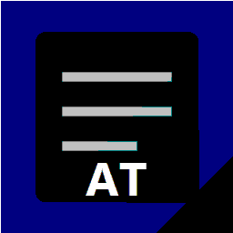
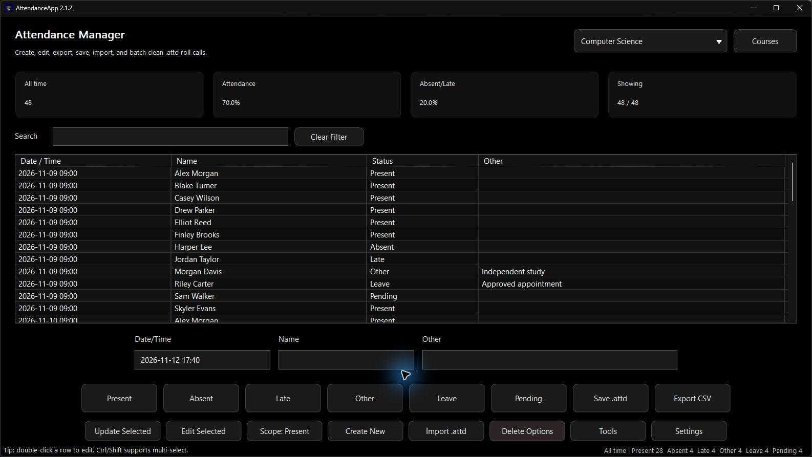
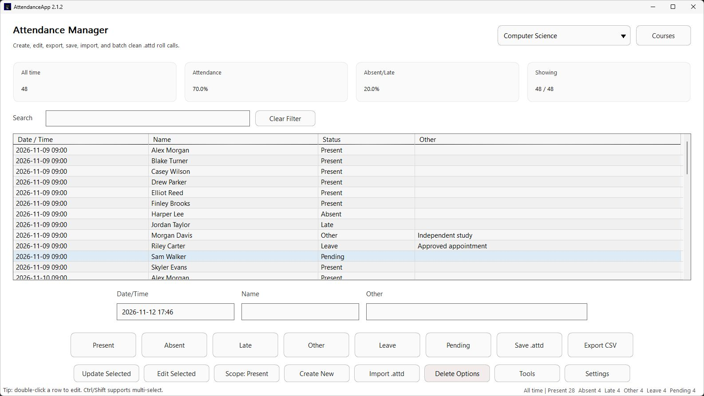
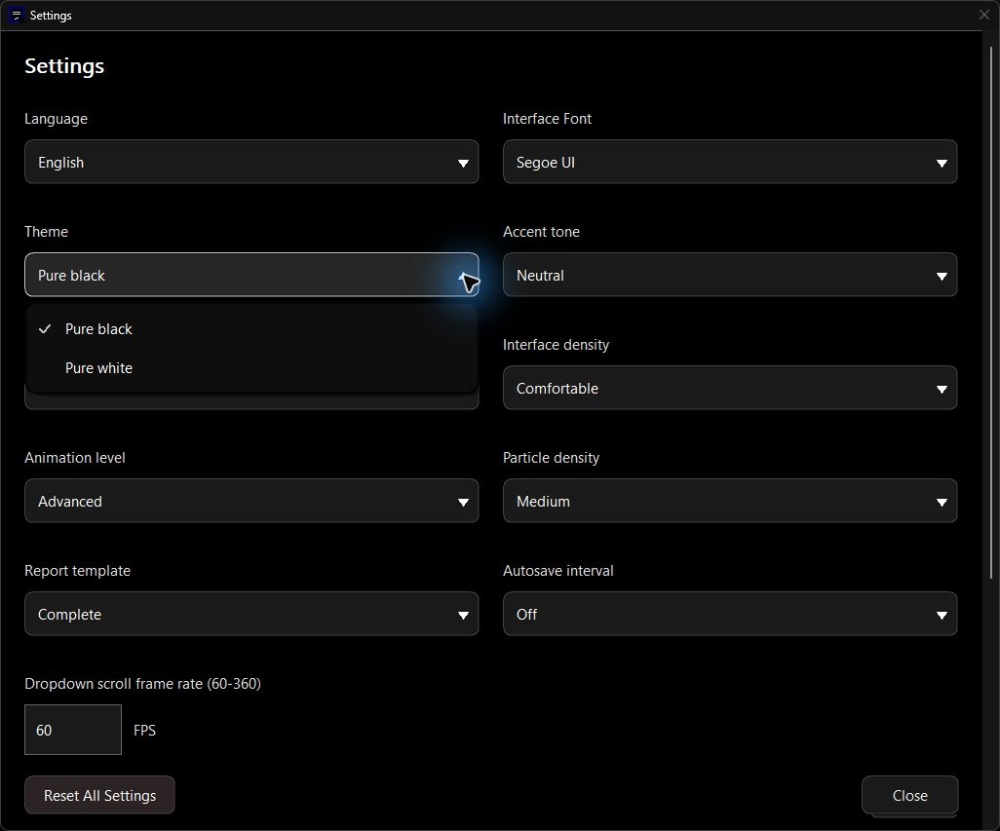
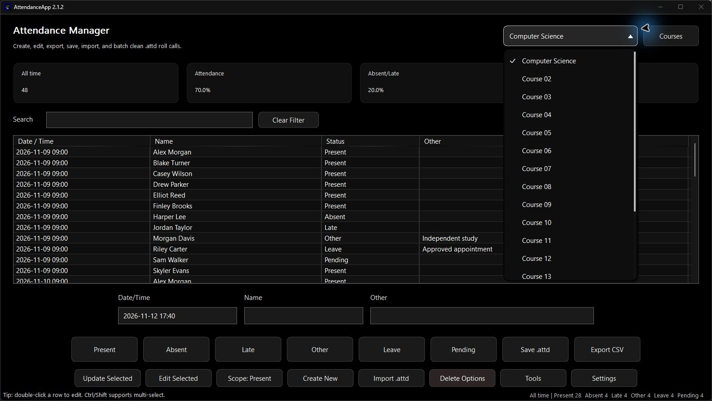
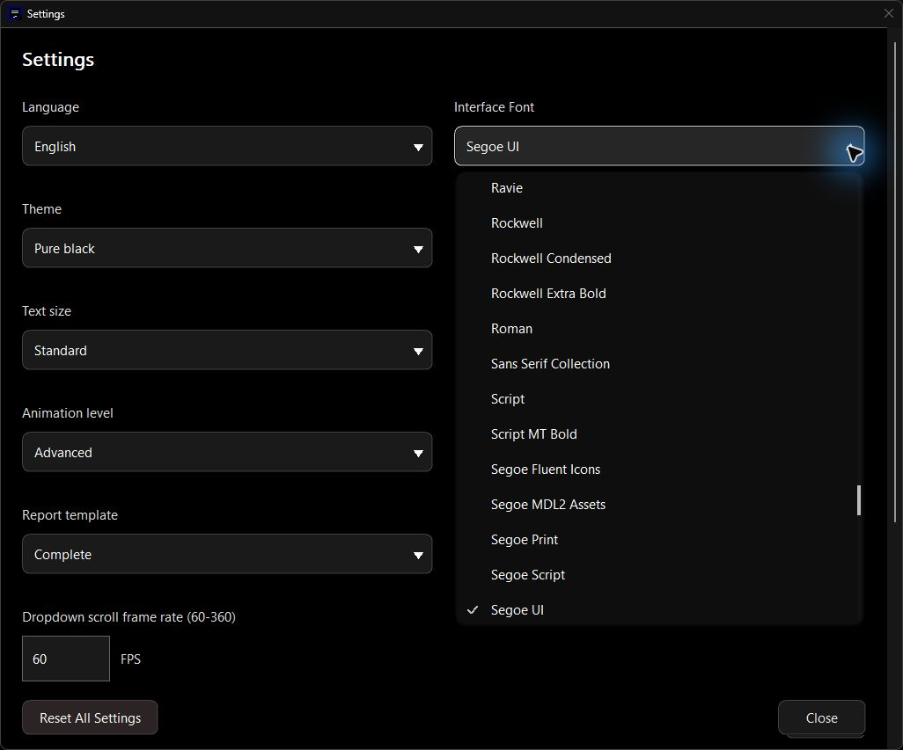
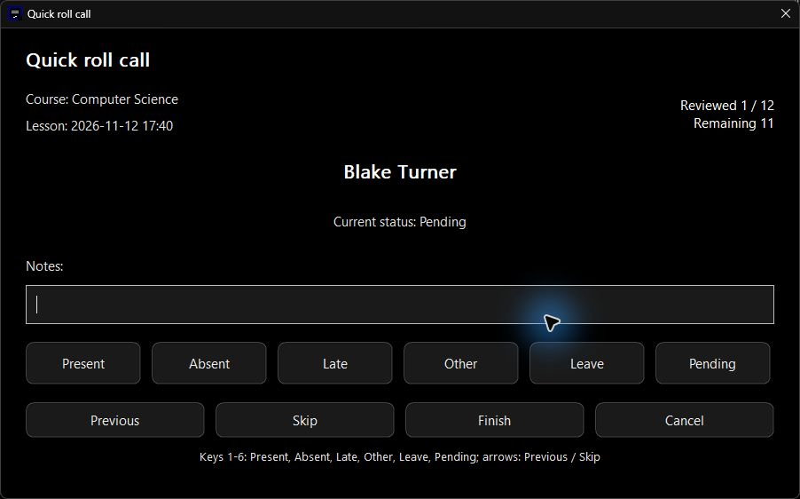
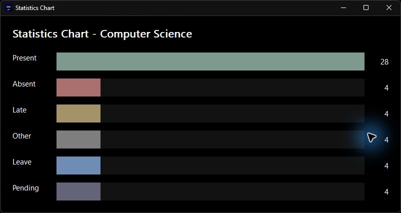
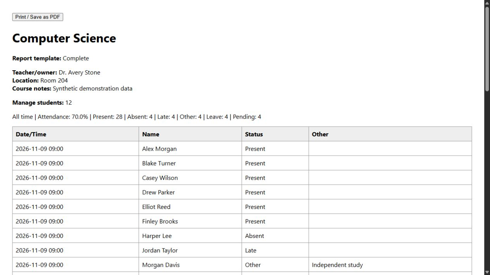

<div align="center">



# AttendanceApp

**Attendance, organized. Your data, on your PC.**

A native Windows attendance manager for courses, rosters, lessons and reports.<br>
Built with C++17 and Win32. Works offline, without an account or server.

[](https://github.com/HongHuo0728/AttendanceApp/releases/latest)
[](https://github.com/HongHuo0728/AttendanceApp/releases)


[](LICENSE)

**[Download](https://github.com/HongHuo0728/AttendanceApp/releases/latest)** ·
[Screenshots](#screenshots) · [Features](#features) · [Build](#build) ·
[Documentation](#documentation) · [All releases](https://github.com/HongHuo0728/AttendanceApp/releases)

</div>

> [!TIP]
> **Ready to use:** download the application ZIP from the latest Release, extract the entire folder, and launch **AttendanceApp.exe**. The GitHub “Source code” archives are for building the application yourself.

## Screenshots

Real screenshots from **2.1.2 LTS**, with English interface text and fictional classroom data. Appearance and available controls can differ in earlier releases.



<details open>
<summary><strong>☀️ Light theme &nbsp; · &nbsp; ⚙️ Settings</strong></summary>

| A clear light theme | Settings with shared dropdowns |
| :---: | :---: |
|  |  |

</details>

<details>
<summary><strong>🧭 Explore the daily workflow</strong></summary>

| Choose a course | Choose a readable font |
| :---: | :---: |
|  |  |
| **Take attendance** | **Review all six statuses** |
|  |  |



</details>

## Features

| | What you can do |
| --- | --- |
| 📚 **Courses & rosters** | Keep separate courses, import student lists from CSV, manage course details and create lessons from a roster. |
| ✅ **Daily attendance** | Record Present, Absent, Late, Other, Leave and Pending; take quick roll calls and apply scoped batch corrections. |
| 🔎 **Find & review** | Filter by lesson or text, use advanced search, review course-local student history and switch statistics periods. |
| 📊 **Reports** | Export CSV, printable HTML and PowerPoint; use the browser's print dialog for PDF. |
| ↶ **Recover your work** | Undo and redo changes, save workbooks atomically, retain backups and restore autosaved data. |
| 🎨 **Make it comfortable** | Choose dark/light themes, fonts, text sizes and density; configure shortcuts, motion and particles. The app supports 20 interface languages. |

**Attendance rate:** Present ÷ (Total − Leave − Pending). Late is separate from Present; an empty denominator displays **No data**.

## Download & quick start

1. Open the **[latest stable Release](https://github.com/HongHuo0728/AttendanceApp/releases/latest)** and download its application ZIP.
2. Extract the complete folder to a location you can keep.
3. Run **AttendanceApp.exe**, create or select a course, and add or import a roster.
4. Create a lesson, mark attendance, then save your workbook as an `.attd` file.

The package includes a quick-start guide, a sample CSV roster and an optional file-association helper. Each user runs an independent local copy.

**Requirements:** Windows 10 or later, x64. The release uses the static MSVC C++ runtime; development tools and a separate MSVC runtime installation are not required. Windows system components are still required.

### Data & compatibility

- Settings, autosave, latest backup and database mirror: `%APPDATA%\AttendanceApp`.
- Backup history and protected recovery copies: its `backups` folder.
- Workbooks and exported reports: the location you choose.
- `ATTENDANCEAPP_DATA_DIR` overrides the application data folder for isolated testing or a separate profile.
- The 2.1 LTS line saves V6 workbooks and reads V1–V5. Older formats are protected before an in-place upgrade. V5 export is a separate, lossy compatibility copy; see the file-format documentation before using it.

> [!IMPORTANT]
> AttendanceApp is a local, single-user tool. Student names identify people within a course; shared editing is not supported. The `.attd` wrapper uses XOR obfuscation and Base64, **not strong encryption**. Keep backups and protect access to the computer and files.

## Build

The maintained **2.1 LTS source** is on [`2.1LTS`](https://github.com/HongHuo0728/AttendanceApp/tree/2.1LTS). This README is the version-independent project overview on `main`; the default branch is not necessarily the latest release source. Use a release tag to reproduce a specific version.

Install Visual Studio or Build Tools with the **Desktop development with C++** workload. CMake 3.20+ is recommended.

```powershell
git clone --branch 2.1LTS https://github.com/HongHuo0728/AttendanceApp.git
cd AttendanceApp
.\build.bat
```

The CMake executable is `build/Release/AttendanceApp.exe`. A direct compiler build is available with `.\build.bat -Direct`, producing `build/AttendanceApp.exe`.

<details>
<summary><strong>🧪 Tests, checks and packaging</strong></summary>

```powershell
.\build.bat -Tests -Analyze
.\scripts\run_tests.ps1 -SkipBuild
.\scripts\verify_release.ps1 -SkipBuild
node scripts/generate_catalog.mjs --check
.\scripts\package_release.ps1
```

Tests use an isolated data directory. Build and test wrappers enforce bounded artifact storage; run them sequentially. Node is needed for translation maintenance, not for building the checked-in C++ sources. Cleanup previews changes unless explicitly executed.

</details>

## Documentation

| Read | Purpose |
| --- | --- |
| [User guide](https://github.com/HongHuo0728/AttendanceApp/blob/2.1LTS/docs/USAGE.md) | Daily workflows, shortcuts, recovery and reports |
| [File format](https://github.com/HongHuo0728/AttendanceApp/blob/2.1LTS/docs/FILE_FORMAT.md) | Compatibility, limits and data representation |
| [Architecture](https://github.com/HongHuo0728/AttendanceApp/blob/2.1LTS/docs/ARCHITECTURE.md) | Modules, state, painting and background work |
| [Testing & storage](https://github.com/HongHuo0728/AttendanceApp/blob/2.1LTS/docs/TESTING_AND_STORAGE.md) | Reproducible verification and artifact budgets |
| [Changelog](https://github.com/HongHuo0728/AttendanceApp/blob/2.1LTS/CHANGELOG.md) | Version-by-version changes |
| [Releases](https://github.com/HongHuo0728/AttendanceApp/releases) | Downloads, release notes and tagged source |

## Feedback & license

Found a problem? [Open an issue](https://github.com/HongHuo0728/AttendanceApp/issues) with the application version, Windows version, display scaling, theme, reproduction steps and expected behavior. Use fictional data when sharing screenshots or sample workbooks.

Distributed under the **[MIT License](LICENSE)**.
