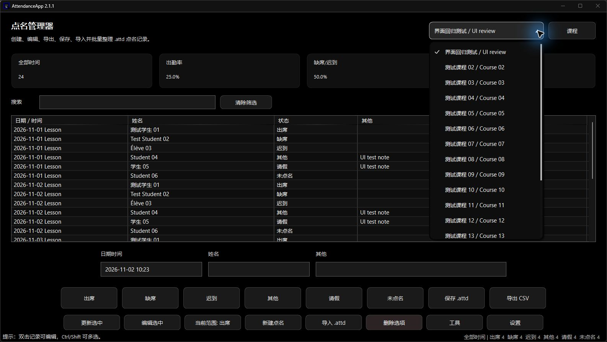
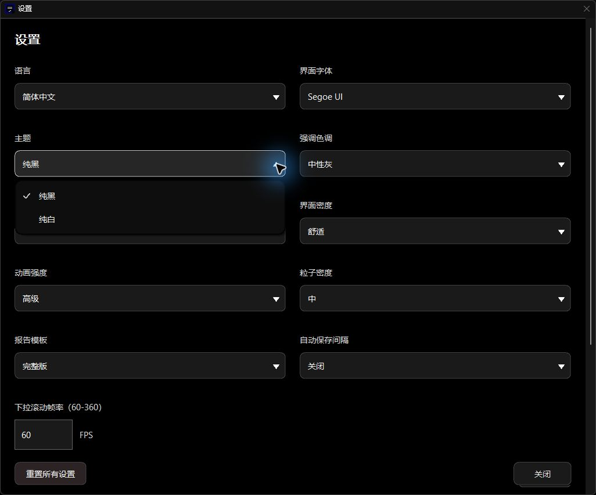
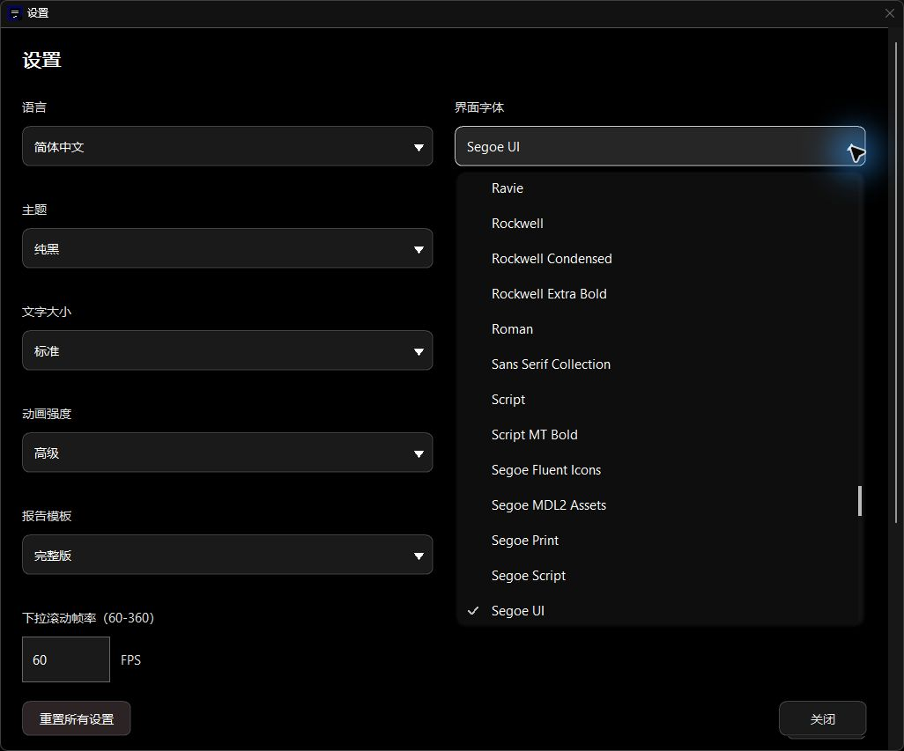
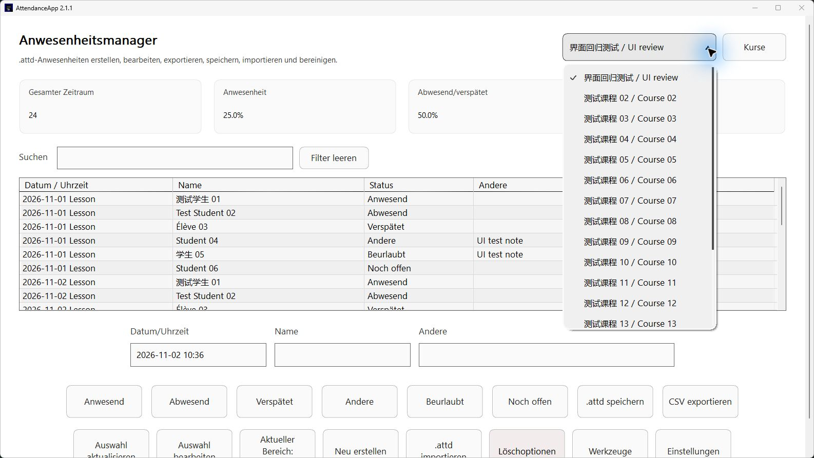
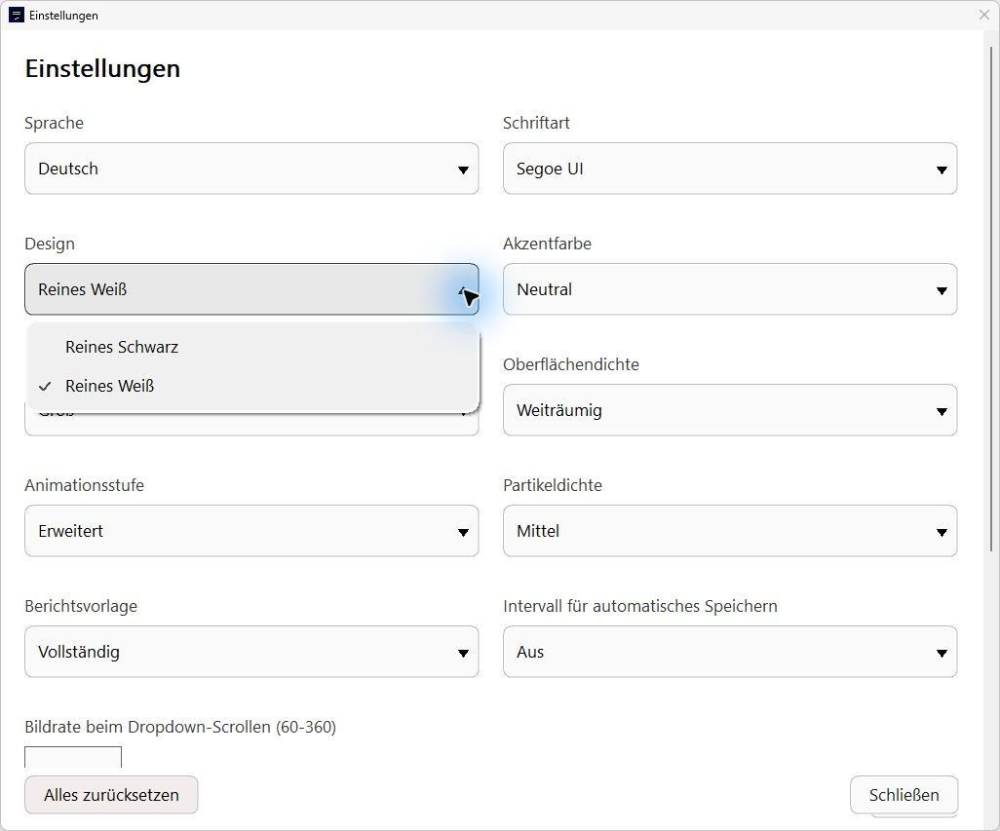
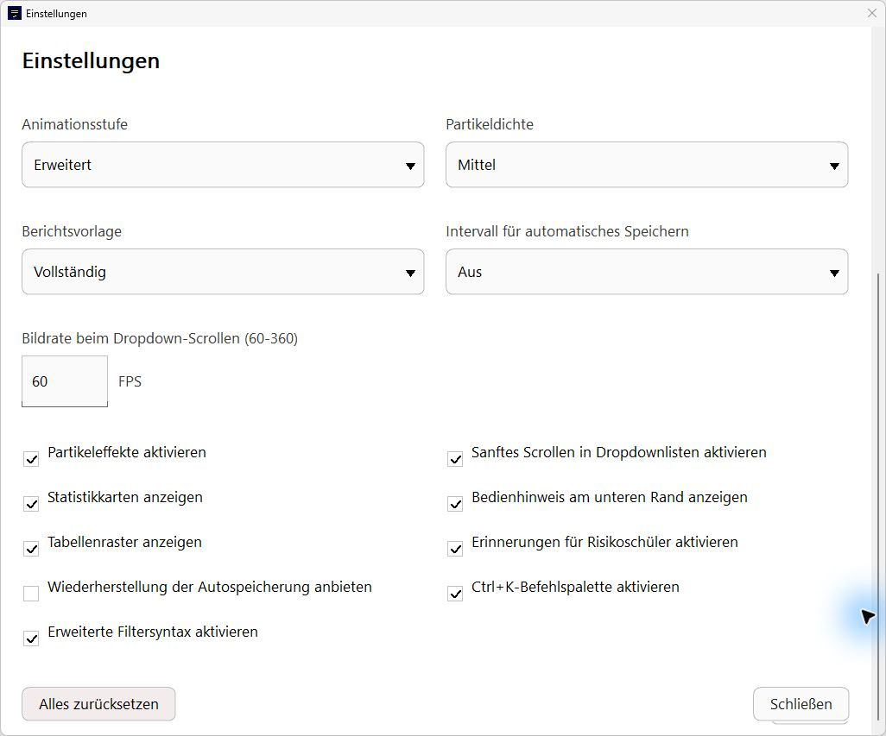
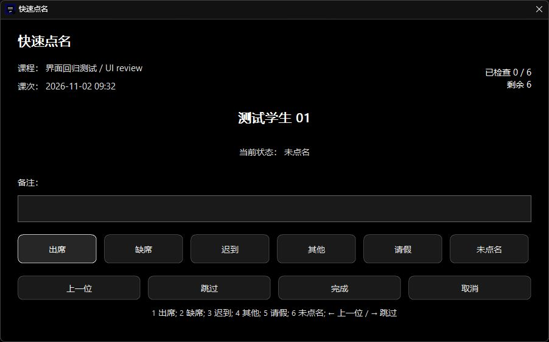
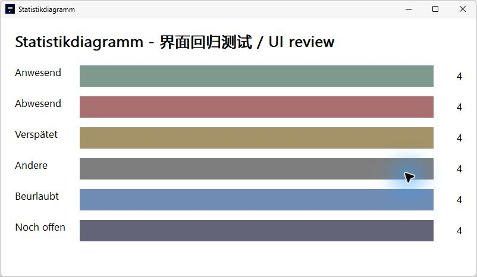

# AttendanceApp v2.1.1 LTS

This maintenance release improves Settings, popup motion, operation feedback and background file processing while preserving the existing themes, attendance workflows and V6 compatibility. This revised draft includes the complete first UI repair and the second settings/dropdown repair.

The first v2.1.1 Release was withdrawn after desktop use exposed substantial UI regressions compared with v2.1.0: overlapping main-window controls, settings scroll stalls, inconsistent dropdown styling and motion, clipped dialogs and charts, and unreliable keyboard or wheel input. The earlier build and automated checks passed, but their coverage did not establish that the complete rendered interface was ready for release. This draft replaces the original notes with the accumulated fixes and actual UI screenshots; it does not republish the withdrawn package.

## Settings

- Remove Apply because settings already take effect and save immediately.
- Keep Reset All Settings and Close visible in a fixed footer while the options scroll.
- Improve long translated labels, large text, keyboard focus scrolling and narrow-window layouts.
- Restart the cached window's entrance on reopening and reverse an in-progress close without rebuilding its controls.
- Add close-generation checks so an obsolete completion cannot hide a newly reopened window.
- Replace jumping settings scroll positions with continuous pixel updates and cached layout geometry. The second repair moves one content window inside a clipped viewport instead of moving and re-clipping every field during scrolling.
- Keep the title and footer outside the scrolling viewport, preserve nested dialog navigation, and scroll focused fields into view.
- Remove composited redirection from Settings and use layered opacity only during fades. Release the layered style at full opacity and repaint once before steady scrolling.
- Forward wheel input over closed settings dropdowns to the form instead of silently changing an option.
- Correct the numeric scroll-FPS input padding and vertical alignment, including its FPS unit after font or native-theme changes.
- Recompute geometry after language changes and update density metrics without losing the title/subtitle font hierarchy.
- Preserve the selected font, default save directory and all six keyboard shortcuts when preferences are saved and reloaded.
- Normalize Windows CRLF endings and UTF-8 BOM markers before parsing preferences, preventing corrupted language, font and numeric values.
- Show a persistent inline warning and Retry when preferences cannot be saved.
- Write reset defaults atomically before applying them; keep the previous settings if the write fails.

## Interface and Motion

- Add paper-style popup reveal using cubic Bezier easing, direction-aware clipping and bounded staggered item entrance.
- Use the same popup implementation as Tools for every settings dropdown and the main course selector to the left of the Courses button. Keep native combo item data and selection notifications while replacing the visible native list.
- Unify Courses, Tools, settings dropdowns and the main course selector across rounded surfaces, spacing, measured rows, hover, focus, clipping, scrolling and close motion.
- Animate the dropdown triangle continuously in both directions. Opening no longer jumps directly to the reversed state, and the return rotation starts when the popup starts closing.
- Align choice menus with their fields, keep them at least as wide as the field, mark the selected item, and initially scroll it into view.
- Give closed combo fields the shared rounded treatment without a separate rectangular arrow compartment.
- Preserve arrow-key, Home/End, Page Up/Down, Enter, Escape, F4, Tab and prefix-typing navigation. Own each popup from its anchor's actual top-level window.
- Cache menu row offsets and sample item entrance once per paint to avoid repeated quadratic work in long font menus.
- Commit a font choice before a deferred font-cache refresh can rebuild the list.
- Improve rounded controls, action-label wrapping, balanced titles and stable-width attendance/progress numbers.
- Respect the existing animation, smooth-scrolling and particle preferences, including immediate final states when motion is disabled.
- Allow standard-motion particles and elapsed-time scrolling to finish their full lifetime. Clear effects and repaint final control states when motion is disabled.
- Queue popup painting and reuse completed clipping geometry rather than forcing synchronous full redraws on every animation tick.

## Operation Feedback and Responsiveness

- Add working, success, warning and failure feedback for save, export, backup and reset.
- Show loading indicators only after 150 ms; do not display invented progress percentages.
- Animate successful action buttons with a drawn check and optional small particle burst. Cancelled and failed actions never show a success check.
- Use a separate non-modal notice for menu-driven tasks.
- Measure notice height from its text and avoid repeated identical placement and repainting after the transition has settled.
- Move workbook file work, CSV filtering, HTML statistics, PowerPoint assembly and backup writes to immutable background snapshots.
- Keep the course, language, template and statistics period captured when an export is requested.

## Bug Fixes

The first UI repair corrects the main layout, rendering, scrolling, dialogs, persistence and window lifecycle. The second repair replaces the remaining settings scroll path and unifies settings/course dropdown styling and two-way arrow motion. Both rounds are included below and in the sections above.

- Prevent the attendance table from overlapping composer labels by measuring the complete title, table, editor, action and footer geometry before placing controls and calculating scroll bounds.
- Keep title/subtitle text inside its header column so long translations cannot run underneath the course selector; align the course action with the selector height.
- Correct downward and horizontal wheel direction, retain small high-resolution wheel steps, and clamp scrolling only after content bounds are known.
- Scroll table records first and pass wheel input to the outer form at a table edge. Forward wheel input from ordinary inputs and closed course selectors as appropriate.
- Replace heavy beveled statistics-card edges with a flat surface and subtle outline. Unify neutral action buttons, preserve the danger tint, smooth rounded edges and match particle clipping to the button radius.
- Avoid repositioning or invalidating settled settings fields. The final viewport implementation supersedes the first repair's per-field position and clipping cache during scrolling.
- Make menu scrollbar thumbs draggable and support page clicks; releasing the scrollbar no longer selects an unrelated command or dismisses the menu.
- Measure all six statistics-chart rows, wrap long titles and labels, constrain the window to the monitor work area, support overflow, finish every bar and apply real close opacity.
- Preserve line breaks in quick-roll-call numeric progress and measure the course, lesson, student, status, notes, actions and hints so large or translated text remains reachable.
- Measure input and confirmation prompts and translated actions; provide selectable, scrollable explanatory text when a message is too long.
- Apply the shared theme to searchable chooser buttons, measure translated labels, preserve a surviving filtered selection, skip unchanged updates and allow horizontal scrolling for long items.
- Follow visual Tab order on the main form, prevent literal Tab insertion into single-line inputs, activate a focused button exactly once with Enter and scroll keyboard focus into view in both directions.
- Preserve WM_QUIT and its exit code during animation cleanup. Destroy the complete child-window hierarchy before joining remaining work and releasing drawing resources.
- Preserve newer unsaved edits when an older captured revision finishes saving.
- Commit imported workbooks only after complete parsing and recovery protection; failed imports retain current data.
- Restore input state after a full queue rejects an import.
- Return parsed course indexes without modifying the current document during worker or migration parsing.
- Deliver background results only to the original living owner window.
- Refresh existing search results immediately when advanced syntax is enabled or disabled.
- Refresh reset settings consistently across timers, fonts, language, grid and shortcuts.
- Regenerate the current build configuration when a copied CMake cache points at a former source folder.
- Recognize adjacent multiline C++ strings in localization checks and complete the three missing Hong Kong Traditional Chinese call-site messages.
- Store regression diagnostics as plain text, cap the summary at 1 MiB and check it against the combined generated-artifact budget before writing. This fixes the oversized diagnostic archive encountered during repair.

## Verification

- CMake Release and direct MSVC Release passed. Both final executables are 1,140,736 bytes and report FileVersion/ProductVersion 2.1.1. Static-runtime import checks passed, and both GUI builds opened and exited with code 0.
- Three consecutive complete regression runs passed after each repair round. The final second-round runs generated 130,161, 130,160 and 130,161 bytes before cleanup; the largest test file was 72,035 bytes.
- Each final run covers 540 main layouts, 360 settings layouts and 60 quick-roll-call/chart combinations across 20 languages, text sizes, layout densities and window dimensions, together with repeated cached-window opening, closing and reversal checks.
- Each final 120-step settings scroll moves the content window 120 times and individual fields zero times. Mean native positioning work was 492, 560 and 427 microseconds on the test machine; this is not complete frame latency.
- Live native popup message loops check the shared Tools menu class, actual owner window, hidden native list, selection versus cancellation, expanded state and intermediate arrow values during both opening and closing for settings and the main course selector.
- Native analysis commands include /analyze; all 62 analysis reports contain no defect entries. Parser, V1-V6 compatibility, undo/redo, backup, background-task and report XML regressions passed.
- Architecture checks resolve 622 local includes across 61 implementation files and 65 headers without a header cycle. Localization checks cover 31 feature, 23 settings and 14 maintenance keys in 20 languages, plus 274 Hong Kong call-site keys; generated catalogs remain consistent.
- Desktop inspection covers Chinese dark standard text and German light large/spacious layouts, main/table wheel routing, Settings top/bottom and fixed actions, menus and font lists, course selection, measured dialogs and the lesson chooser, six-state charts, quick-roll-call progress and note validation, and a 24-record CSV export.
- ZIP CRC, embedded-executable hashes and reverse checks for incremental and cumulative repair patches passed. The final direct build sampled 403.55 MiB of generated artifacts, below the 512 MiB budget; intermediate cleanup left 6.90 MiB. Tests remain below 20 MiB total and 5 MiB per file.
- The second-round local repair candidate is AttendanceApp-2.1.1-LTS-UI-repair2-2026-11-02.zip, 513,027 bytes. SHA-256: `479f475620d1a420132fd30c737046f837f597f4138872c9ea2621d3ba6f090e`.
- The candidate executable SHA-256 is `92fad1a7ac5f04de81d391c27e15242a1203216ac77de29068a2ad7c11abf39c`.

## Compatibility and Notes

- Continue the [2.1 LTS maintenance series](https://github.com/HongHuo0728/AttendanceApp/tree/2.1LTS). FileVersion and ProductVersion are 2.1.1; the release tag is v2.1.1.
- Continue writing ATTENDANCE_V6, reading V1-V5 and offering the existing separate V5 compatibility export.
- Preserve existing settings keys and production data limits. Fourteen maintenance messages cover all 20 interface languages.
- Keep this Release as a draft. The first package, AttendanceApp.v2.1.1.zip (515,181 bytes; SHA-256 `527e7cb26f31b0c8a43bc5a294a3550ecb2ba72c379102ab65c2e6e64bba5ff2`), is withdrawn and must not be distributed as the repaired build. It is retained only for traceability; the second-round candidate has not been republished through this draft.
- The first release was withdrawn because the observed interface did not meet release quality despite passing the earlier checks. The original coverage concentrated on functionality and selected settings geometry and did not adequately verify the complete main window, visible interaction and motion. The revised checks and screenshots address those gaps without claiming that every undiscovered UI defect is impossible.
- Keep the original v2.1.1 tag and historical attachment unchanged while this draft is reviewed. The repair code is on 2.1LTS; a future publication must use a matching repaired source snapshot and package.
- Use only isolated synthetic courses, students and settings for regression and desktop screenshots. Real attendance files and AppData preferences were not modified.
- The Computer Use wrapper activates the main window before input, limiting reliable second-click selection in some owned Settings popups. Native live-message-loop checks supplement those selection paths.
- Current checks do not establish that every rendered frame is flicker-free. High-speed animation recording, the full Windows scaling matrix, clean-machine GUI startup and complete native-speaker review of all 20 languages remain unverified.
- See the [original 2.1.1 audit](V2.1.1_AUDIT.md), [first UI repair](V2.1.1_UI_REPAIR.md) and [settings/dropdown follow-up](V2.1.1_SETTINGS_POPUPS.md) for causes, implementation, verification and limits. Repair commits: [8c2a1c8](https://github.com/HongHuo0728/AttendanceApp/commit/8c2a1c899f74f9d310c2dbb935ea3e1d168b599d) and [92c8cbe](https://github.com/HongHuo0728/AttendanceApp/commit/92c8cbed65188773245768652d3df9f10a2a6597).

Main window and course selector, Chinese dark theme. The selected-item mark, shared popup styling and separated table/composer layout are visible.

Settings and the shared theme dropdown, Chinese dark theme, with the fixed title and footer.

Long font dropdown, showing the selected font scrolled into view.

Main window and course selector, German light theme with large text and spacious density.

Settings and theme dropdown, German light theme with large text.

Settings scrolled to the bottom, with the title and Reset All Settings / Close actions fixed in place.

Quick roll call, showing two-line progress and all six attendance actions.

Statistics chart, showing all six status rows and completed bar widths in German with large text.

