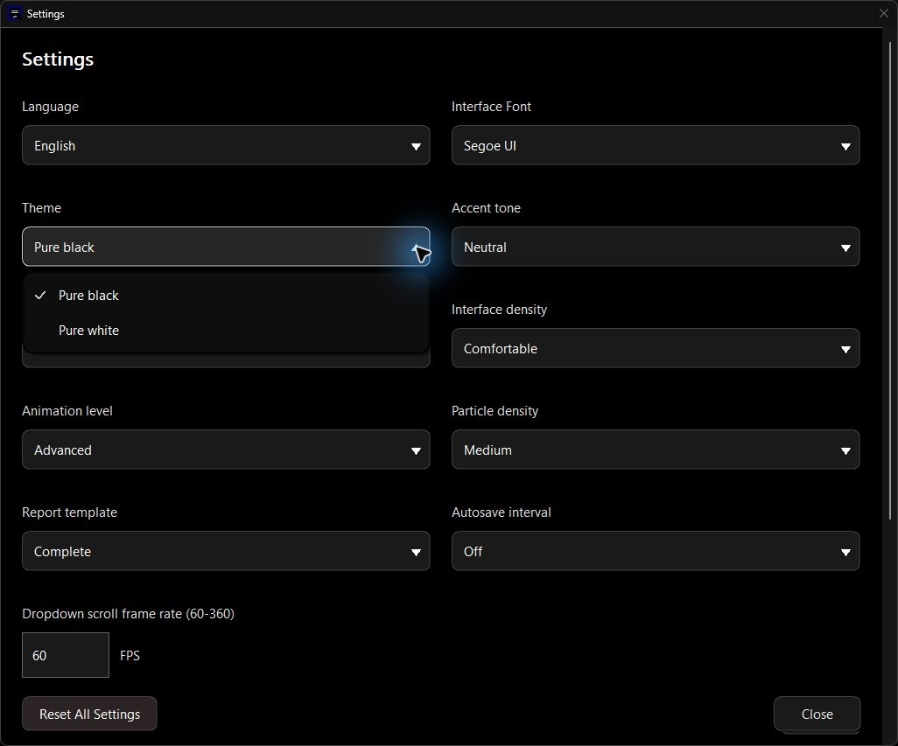
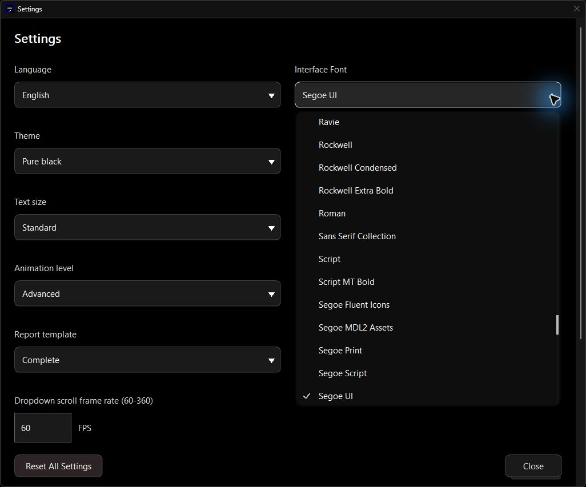
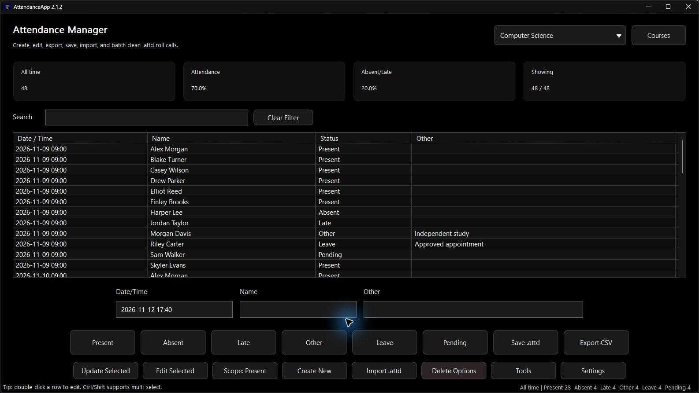
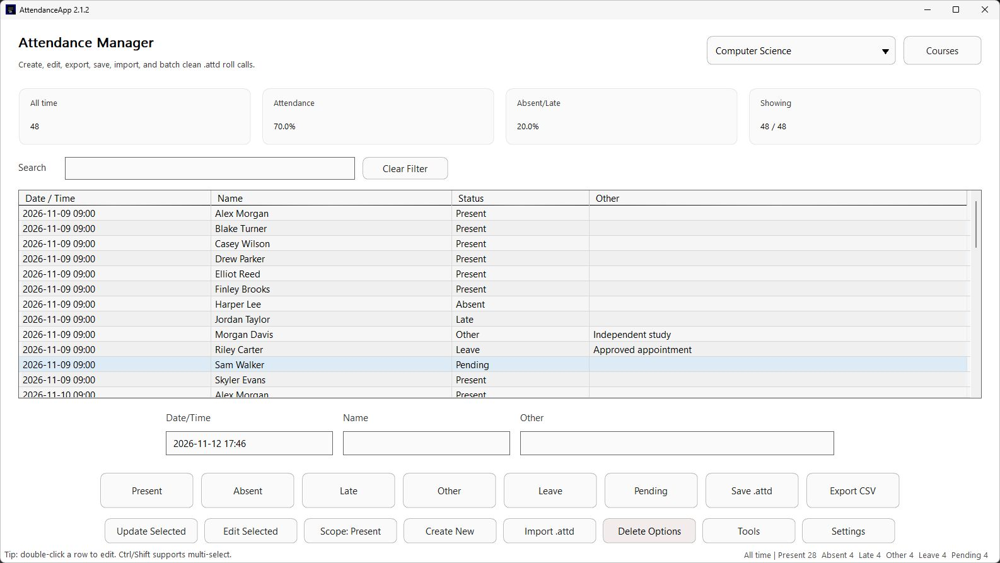
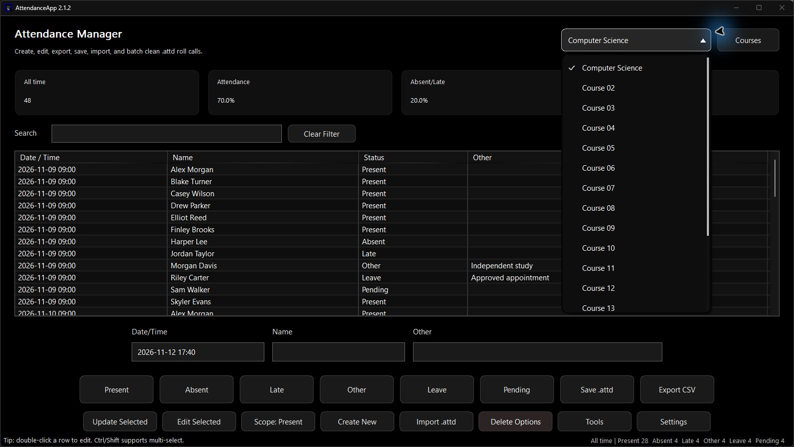
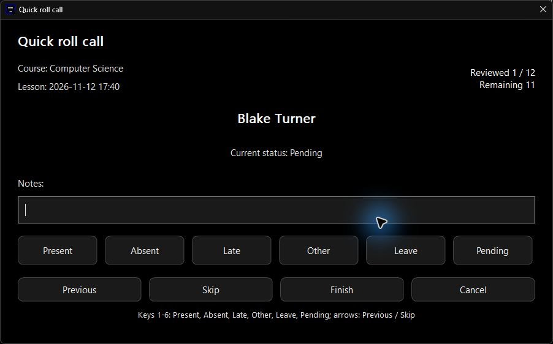
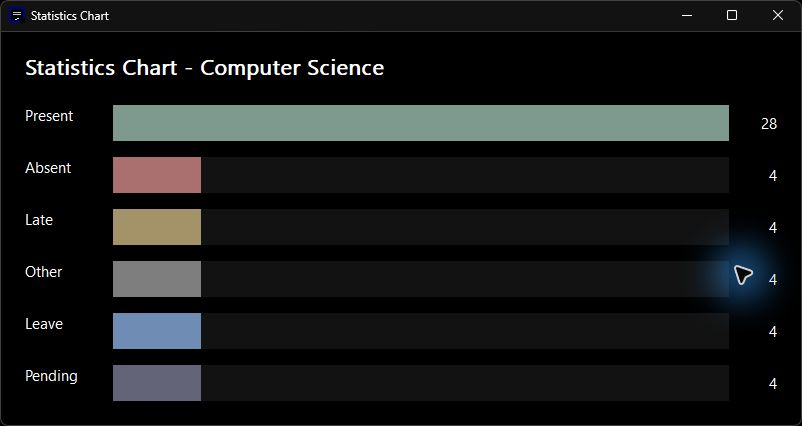
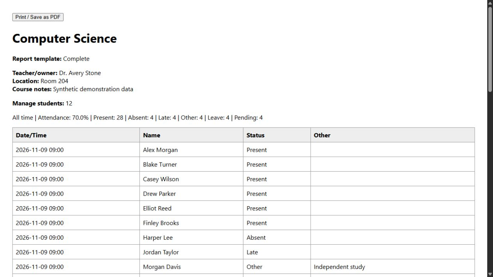

# AttendanceApp v2.1.2 LTS

This maintenance release repairs popup navigation and sizing, input handling, transactional data validation, roster import and report output. It retains the existing appearance options, attendance workflows and V6 compatibility. The project README has also been rebuilt as an English, version-independent overview with eight new screenshots from the final 2.1.2 program and its HTML report.

## Settings

- Correct shared dropdown width against the anchor monitor after applying the field width, so oversized fields cannot push a menu beyond the work area.
- Reserve scrollbar and checkmark space when measuring long menu labels, preventing wrapped text from being clipped.
- Correct repeated-initial cycling and prefixes containing spaces in combo menus, including the font selector.
- Update the settings smoke-script lookup and architecture documentation for the nested viewport/content implementation. The legacy PowerShell smoke script was corrected by source review; it was not run for this release.

## Interface and Motion

- Apply the popup boundary and keyboard fixes to the shared Tools, Settings and course-menu implementation.
- Restore keyboard focus to the command menu's invoking button when the owner remains active.
- Retain existing opening/closing motion and motion-off behavior; native popup checks verify intermediate arrow states in both directions and selection versus cancellation.
- Replace the project overview with an English gallery, consistent blue/purple badges, clear download guidance and an explicit LTS source link.

## Operation Feedback and Responsiveness

- Validate complete candidate workbooks before changing live records, course details, rosters, generated lessons or completed roll calls. Rejected changes leave data and undo history intact.
- Parse roster imports completely before committing them, so malformed CSV cannot silently produce a partial roster.
- Preserve unmodified typing in edit fields when a single-letter shortcut is configured; reject unintended Shift combinations.
- Keep the existing single-content-window settings scroll path. Three final 120-step checks moved the content container 120 times and individual fields zero times.

## Bug Fixes

- Route composing IME key messages before global shortcuts and custom dialog actions.
- Make Enter activate a focused Cancel button in text dialogs instead of accepting the value.
- Treat roster headers only at the first nonblank record; retain later students named Name or Student.
- Reject malformed quotes, invalid UTF-8 in imported names and embedded NUL in decoded/model fields.
- Reject duplicate course names and whitespace-only required record fields; preserve unchanged course names as a no-op.
- Validate calendar dates before applying `from:` / `to:` comparisons, excluding undated or impossible-date labels.
- Protect spreadsheet-facing CSV cells with formula/control prefixes while preserving exact workbook and database text.
- Replace XML 1.0 forbidden characters before generating PowerPoint XML.

## Verification

- CMake Release, direct MSVC Release, version metadata, static-runtime dependency checks and native analysis passed. All 62 analysis reports contain zero defect entries.
- Three consecutive final isolated regression runs passed, including V1-V6 reads, V5 compatibility export, transactions, undo/redo, failed writes, recovery, background ownership, queue rejection and report XML checks.
- Each run checked 540 main layouts, 360 settings layouts and 60 roll-call/chart combinations across 20 languages and supported text/density combinations. These are native fixtures and geometry checks, not a claim of complete physical GUI coverage.
- Thirty cached-settings cycles checked GDI and USER counts, close reversal and stale completions. Settings positioning means were 427, 395 and 555 microseconds; this is not full-frame latency.
- Architecture, localization and generated-catalog checks passed. The direct build's sampled artifact peak was 424,493,391 bytes, below the 512 MiB budget. Final tests generated 130,326 / 130,322 / 130,327 bytes.
- Actual desktop inspection covered English dark/light UI, menus, settings scrolling and fixed actions, roll-call progress/note rejection/cancellation, statistics and HTML export. The extracted ZIP was also launched with large/spacious and small/compact preferences; German was checked only as internal verification.
- ZIP CRC and embedded-executable matching passed. See the [2.1.2 audit](https://github.com/HongHuo0728/AttendanceApp/blob/v2.1.2/docs/V2.1.2_AUDIT.md) for reproduction conditions, repairs, machine-readable evidence and coverage limits.

## Compatibility and Notes

- Windows 10 or later, x64. Extract the complete ZIP and run `AttendanceApp.exe`.
- V6 remains the normal save format. V1-V5 reading, protected migration and separate V5 compatibility export remain supported. No new Student ID, structured-date, audit-trail or encryption system is introduced.
- Windows display-scale changes were cancelled at the user's request. The existing 100% setting was not changed; 125%, 150% and 200% desktop scaling were not verified. Full physical IME candidate handling, multiple monitors and a clean Windows installation remain unverified.
- CSV export protection can be reinterpreted by spreadsheet software after editing or re-saving. `.attd` still uses XOR/Base64 obfuscation, not strong encryption.
- All gallery images use English interface text and fictional data from 2.1.2. The 2.1.1 Release, images, attachment and tag remain unchanged.
- Maintained source: [`2.1LTS`](https://github.com/HongHuo0728/AttendanceApp/tree/2.1LTS). Reproducible release source: [`v2.1.2`](https://github.com/HongHuo0728/AttendanceApp/tree/v2.1.2). `main` remains the version-independent project entry point.
- Download: [AttendanceApp.v2.1.2.zip](https://github.com/HongHuo0728/AttendanceApp/releases/download/v2.1.2/AttendanceApp.v2.1.2.zip), **534,303 bytes**.
- SHA-256: `f50ec83e30bd72652dcc7f0edcbe4696562f123e94147fb5b21e986583372768`.
